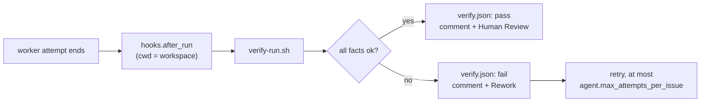
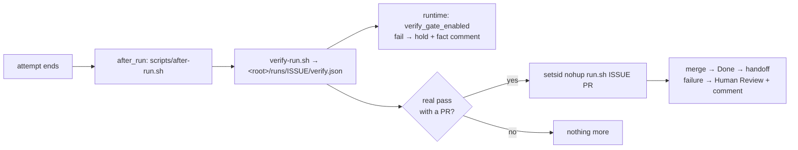

# Post-run gate (`hooks.after_run` → `scripts/verify-run.sh`)

Symphony used to take a worker's "done" at face value. The post-run gate makes the runtime check the facts itself
after every attempt. It is configuration plus one script: no Elixir change, so it stays out of the way of upstream.



## What the runtime hands the hook

`Workspace.run_after_run_hook/3` runs `sh -lc <after_run>` with the workspace as cwd, on `Task` timeout
`hooks.timeout_ms`, and then discards the result (`ignore_hook_failure`). There are no arguments, no
issue-specific environment and no outcome of the attempt. The script therefore:

- takes the workspace from `$PWD` (the hook passes it explicitly) and derives the issue id from the directory name
  (`Workspace.workspace_key`: the identifier, or `<safe id>--<16 hex>`, which it strips);
- derives everything else (branch, HEAD, upstream) from git;
- inherits Symphony's environment, so `LINEAR_API_KEY` and `gh` auth are the ones Symphony already uses.

The hook runs inside the worker's `after` block, so it also runs when the attempt crashed.

## Facts

| Fact | OK when | Notes |
| --- | --- | --- |
| `clean_tree` | `git status --porcelain` is empty | untracked files count |
| `pushed` | upstream exists and `git rev-list @{u}..HEAD` is 0 | no upstream = unpushed |
| `pr` | a non-draft PR exists for the branch, open or merged | `gh pr list --head <branch> --state all`; open PRs win |
| `ci` | `gh pr checks` has no failing check; none pending after `ci_wait_s` | no checks configured = ok |
| `tests` | `verify.test_command` exits 0 in the workspace | re-run by the runtime, never read from the worker |

The verdict is `pass` only if every fact is ok. A missing `test_command` is a failed `tests` fact (fail closed).

## `runs/<issue>/` (under the operator checkout, git-ignored, outside the workspace)

- `verify.json` – latest result, schema below
- `comment.md` – the Linear comment that was (or would be) posted
- `test.log` – full output of the test run; `worker-tail.txt` – last 40 worker log lines mentioning the issue
- `history.jsonl` – one line per attempt; `attempt` – the counter

```json
{
  "verdict": "pass | fail",
  "issue": "JARVIS-3790",
  "attempt": 2,
  "facts": [{"name": "tests", "ok": false, "detail": "exit 1"}],
  "pr": {"number": 42, "url": "…", "isDraft": false, "state": "OPEN"},
  "tests": {"command": "cd elixir && mise exec -- mix test", "exit_code": 1, "tail": "last 40 lines"},
  "worker_tail": "last 40 Symphony log lines for the issue",
  "dry_run": false,
  "branch": "feature",
  "workspace": "/…/JARVIS-3790",
  "workspace_head": "<sha>",
  "checked_at": "2026-10-22T03:00:00Z"
}
```

`pr` is `null` when no PR was found (or in dry runs). Test and worker tails are scrubbed for common token shapes.

## Linear comment (fixed format)

```
## Symphony post-run verification: FAIL (attempt 2)

| Fact | Result | Detail |
| --- | --- | --- |
| clean_tree | pass | no uncommitted changes |
| tests | FAIL | exit 1 |

Workspace HEAD `abc123def456` on `feature`, checked 2026-10-22T03:00:00Z. The tests above were re-run by the runtime, not reported by the worker.

Last lines of the test run:   (fail only)
Next state: Rework.

🤖 Symphony
```

State change: the issue moves to `Rework` on fail and `Human Review` on pass, but only from `Todo`, `In Progress` or
`Rework`. `Merging`, `Human Review`, `Done` and the other states are left alone (the comment is still posted).

## Switches

Config lives in `elixir/WORKFLOW.md`. `hooks.after_run` and `hooks.timeout_ms` are ordinary hook settings; the
top-level `verify:` block is read by the script only (flat `key: value` lines), and the runtime ignores it.

| Setting | Env override | Default |
| --- | --- | --- |
| `verify.test_command` | `VERIFY_TEST_COMMAND` | none (fails closed) |
| `verify.test_timeout_s` | `VERIFY_TEST_TIMEOUT_S` | 1500 |
| `verify.ci_wait_s` | `VERIFY_CI_WAIT_S` | 0 (WORKFLOW sets 300) |
| `verify.worker_log` | `VERIFY_WORKER_LOG` | none (tail left empty) |
| – | `VERIFY_RUN_DRY=1` | off: skip `gh` and Linear, record `pr`/`ci` as skipped |
| – | `VERIFY_WORKFLOW`, `VERIFY_RUNS_DIR`, `VERIFY_ISSUE_ID` | `elixir/WORKFLOW.md`, `<repo>/runs`, from dir name |
| – | `SYMPHONY_REPO` (hook only) | `~/Developer/Project/symphony`, where `scripts/verify-run.sh` lives |

`hooks.timeout_ms` must stay above `test_timeout_s + ci_wait_s`; otherwise Symphony kills the gate mid-run and no
verdict is written. The same WORKFLOW turns on `agent.hold_after_normal_completion` and
`agent.max_attempts_per_issue: 3`, so a normally finished attempt is held for the verdict and a stuck issue stops
after three tries instead of looping.

## Runtime veto: `agent.verify_gate_enabled` (JARVIS-3792)

The hook's own result is still discarded by `Workspace.run_after_run_hook/3`. The veto is therefore a separate,
opt-in read of `verify.json` on the normal-exit path (`Orchestrator.handle_agent_down(:normal …)`, one `cond`
clause, logic in `SymphonyElixir.VerifyGate`).

| Setting | Default | Meaning |
| --- | --- | --- |
| `agent.verify_gate_enabled` | `false` | off: the clause is skipped and nothing is read; behaviour is identical to before |
| `agent.verify_record_path` | `runs/<issue>/verify.json` | `<issue>` = issue identifier; a relative path is resolved against the local workspace root |

With the flag on, a normal exit completes only if the record exists, is a fresh (`checked_at` not before the run
start), real (`dry_run: false`) `pass` and every fact is ok. Anything else (missing → "閘門未產出", dry run → "乾跑不算通過",
unparsable, stale, failing facts) puts the issue in the existing `normal_completion_hold` with the failing facts as
reason and posts a fact comment (Linear only, best effort, signed `🤖 Symphony`). A pass falls through to the old
flow, including `hold_after_normal_completion`.

- Keep `agent.hold_after_normal_completion: true` together with the gate: the gate reuses the
  `normal_completion_hold` disposition, which a config reload releases when that flag is off.
- A hold is sticky (no automatic retry): the operator releases it by moving the issue out of the active states or
  restarting. The Rework state change and the comment on a real fail still come from the S1 script.
- The record must be where the runtime looks: either set `VERIFY_RUNS_DIR=<workspace root>/runs` for the hook or set
  `agent.verify_record_path` to an absolute path template matching `<repo>/runs/<issue>/verify.json`.
- `SymphonyElixir.StopFile.stopped?/0` (a `STOP` file in the workspace root) and
  `SymphonyElixir.VerifyGate.attempt_fields/1` (`last_line`, `diagnostic_tail` from the record) exist but are not
  wired yet; see JARVIS-3793.

## Operator (`scripts/after-run.sh`, JARVIS-3793)

After a real pass, a headless `claude -p` (Sonnet 5.5) merges the PR, sets the issue Done, tidies the local checkout and
writes a memory handoff. It is event-driven: the only trigger is the `after_run` hook below. No desktop session, no cron.
The Operator itself (merge gate, prompt, failure handling) lives in jarvis-personal `scripts/operator/` and is described
in its `docs/operator.md`; this repo only wires it in.



- **One file for both readers.** `verify-run.sh` defaults to `<repo>/runs`, the runtime reads
  `agent.verify_record_path` (default `runs/<issue>/verify.json`) relative to the workspace root. Chosen: the hook sets
  `VERIFY_RUNS_DIR=<workspace root>/runs` (the parent directory of the workspace), so `verify_record_path` keeps its
  default and nothing in `lib/` or the runtime config changes. The alternative (an absolute `verify_record_path` under
  `<repo>/runs`) would pin the runtime to one checkout path; deriving from the workspace follows whatever
  `workspace.root` the lane uses. `VERIFY_RUNS_DIR` in the lane environment still overrides it, but then
  `agent.verify_record_path` must point at the same directory.
- **Gate on.** `agent.verify_gate_enabled: true` with `hold_after_normal_completion: true`, `max_attempts_per_issue: 3`
  and `dispatch_lint_enabled: true`. A failing gate holds with a fact comment; a pass is also held until the Operator
  moves the issue (Done) or the owner does (Human Review).
- **Asynchronous.** The Operator is detached with `setsid nohup`, so the hook returns right after the verdict and the
  Operator's 20 minutes do not count against `hooks.timeout_ms`. Its output goes to `runs/<issue>/operator.log` (token-redacted).
  Only a `pass` with `dry_run: false` and a PR starts it; a fail never does.
- **Paths.** `SYMPHONY_REPO` (this checkout, default `~/Developer/Project/symphony`), `JARVIS_PERSONAL`
  (default `~/Developer/Project/jarvis-personal`), `OPERATOR_LOCAL_REPO` (default `$SYMPHONY_REPO`, fast-forwarded in
  step 4), `OPERATOR_DISABLE=1` to verify only. A missing `run.sh` is reported and skipped, never fatal.
- **`verify.worker_log`** is `~/.local/state/symphony/symphony-fork/log/symphony.log.1`, i.e. `<--logs-root>/log/symphony.log.1` (the runtime writes a disk_log wrap log: `symphony.log.1` plus `.idx`/`.siz`; there is no plain `symphony.log`)
  of `symphony-fork.service`; a lane with another `--logs-root` sets `VERIFY_WORKER_LOG`.
- **Self-test:** `scripts/test-after-run.sh` (fake verify script and fake Operator).
- **Open, not wired:** the `STOP` file check and `VerifyGate.attempt_fields/1` still need runtime changes (S6).

## Known limits

- The runtime does not tell the hook which backend ran or whether the attempt failed, and does not put the diagnostic
  tail into its own attempt record; the tail is taken from the Symphony log file (`verify.worker_log`) and exposed by
  `VerifyGate.attempt_fields/1` (not yet on `/api/v1/state`).
- Linear comment and state change need `LINEAR_API_KEY`; without it the script still writes `verify.json`.
- Run `scripts/test-verify-run.sh` to self-test (temporary git workspaces, fake `gh` and `curl`).
